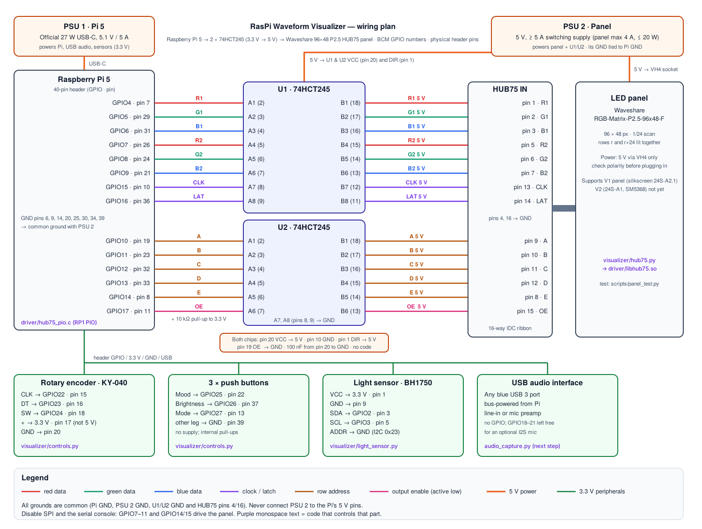

# RasPi Waveform Visualizer

A Raspberry Pi 5 music visualizer that listens to live music, takes a mood from the user, and will add lyric-based emotion. It renders to a **Waveshare 96×48 P2.5 flexible HUB75 LED panel**.

This stage contains the **display hardware and our own panel driver**: a custom level-shifter board built from two **74HCT245** chips, a C driver that uses the Pi 5's **RP1 PIO** block, plus the code for the controls and light sensor. Audio capture, song recognition and lyric emotion come next (see [Roadmap](#roadmap)).

> **Status:** the code is written and syntax-checked, and the test script runs in simulator mode. It has **not yet been tested on real hardware**. Bring it up with the panel test at low brightness, ideally with a logic analyser on the HUB75 lines.



The full-resolution diagram is [`docs/wiring.svg`](docs/wiring.svg).

---

## Contents

1. [How it works](#how-it-works)
2. [Parts list](#parts-list)
3. [Connections, pin by pin](#connections-pin-by-pin)
4. [Power plan](#power-plan)
5. [Which code drives which part](#which-code-drives-which-part)
6. [Building the level-shifter board](#building-the-level-shifter-board)
7. [Software setup](#software-setup)
8. [Bring-up and testing](#bring-up-and-testing)
9. [Driver internals](#driver-internals)
10. [Tuning and troubleshooting](#tuning-and-troubleshooting)
11. [Limitations](#limitations)
12. [Roadmap](#roadmap)

---

## How it works

```
USB audio ─┐
Encoder ───┤                    ┌──────────── RP1 PIO ────────────┐
Buttons ───┼─> Python app ──> libhub75.so ──> 14 GPIO ──> U1/U2 74HCT245 ──> HUB75 ribbon ──> panel
BH1750 ────┘   (visualizer/)    (driver/)     3.3 V        5 V
```

- The **Pi 5** produces frames (96×48 RGB) in Python.
- **`driver/libhub75.so`** turns each frame into a bit stream and feeds it to a PIO state machine. The PIO generates the HUB75 timing in hardware, so refresh stays steady with little CPU load.
- **U1 and U2 (74HCT245)** shift the Pi's 3.3 V signals up to the 5 V the panel expects. They replace the level shifters on an Adafruit HAT.
- The **panel** is powered from its own 5 V supply.

## Parts list

| Qty | Part | Notes |
|---|---|---|
| 1 | Raspberry Pi 5 (4 GB or 8 GB) | 8 GB recommended once lyric models are added |
| 1 | Official Raspberry Pi 27 W USB-C power supply | PSU 1, Pi only |
| 1 | Raspberry Pi Active Cooler | needed under sustained load |
| 1 | Waveshare RGB-Matrix-P2.5-96x48-F | includes HUB75 ribbon and power cable |
| 1 | 5 V switching supply, ≥ 5 A (e.g. 5 V 10 A) | PSU 2, panel and buffers |
| 2 | 74HCT245 octal buffer, DIP-20 | **HCT**, not HC: HCT accepts 3.3 V as a logic high at 5 V supply |
| 2 | DIP-20 sockets | so the chips can be swapped |
| 2 | 100 nF ceramic capacitors | one per chip, decoupling |
| 1 | 10 kΩ resistor | OE pull-up, keeps the panel dark during boot |
| 1 | 2×8 (16-pin) shrouded IDC header, 2.54 mm | HUB75 output on the board |
| 1 | 2×20 female header or GPIO ribbon + breakout | connects board to the Pi |
| 1 | 2-pin screw terminal | 5 V in from PSU 2 |
| 1 | Perfboard / stripboard (~7 × 9 cm) | |
| 1 | KY-040 rotary encoder | mood |
| 3 | 12 mm momentary push buttons | mood, brightness, mode |
| 1 | BH1750 breakout | ambient light, auto-brightness |
| 1 | USB audio interface or USB mic | audio input (no GPIO) |
| — | Hook-up wire, Dupont jumpers | keep HUB75 signal wires short (< 20 cm) |

Optional but very useful: a cheap 8-channel logic analyser for checking CLK/LAT/OE timing.

## Connections, pin by pin

GPIO numbers are **BCM** numbers. "Pin" means the physical pin on the Pi's 40-pin header.

### Pi → level shifters → HUB75

The driver needs all 14 HUB75 signals on one contiguous block, **GPIO4–GPIO17**. That is why SPI and the serial console must be turned off.

| Signal | Pi GPIO | Pi pin | Buffer input | Buffer output | HUB75 pin |
|---|---|---|---|---|---|
| R1 | GPIO4 | 7 | U1 A1 (pin 2) | U1 B1 (pin 18) | 1 |
| G1 | GPIO5 | 29 | U1 A2 (pin 3) | U1 B2 (pin 17) | 2 |
| B1 | GPIO6 | 31 | U1 A3 (pin 4) | U1 B3 (pin 16) | 3 |
| R2 | GPIO7 | 26 | U1 A4 (pin 5) | U1 B4 (pin 15) | 5 |
| G2 | GPIO8 | 24 | U1 A5 (pin 6) | U1 B5 (pin 14) | 6 |
| B2 | GPIO9 | 21 | U1 A6 (pin 7) | U1 B6 (pin 13) | 7 |
| CLK | GPIO15 | 10 | U1 A7 (pin 8) | U1 B7 (pin 12) | 13 |
| LAT | GPIO16 | 36 | U1 A8 (pin 9) | U1 B8 (pin 11) | 14 |
| A | GPIO10 | 19 | U2 A1 (pin 2) | U2 B1 (pin 18) | 9 |
| B | GPIO11 | 23 | U2 A2 (pin 3) | U2 B2 (pin 17) | 10 |
| C | GPIO12 | 32 | U2 A3 (pin 4) | U2 B3 (pin 16) | 11 |
| D | GPIO13 | 33 | U2 A4 (pin 5) | U2 B4 (pin 15) | 12 |
| E | GPIO14 | 8 | U2 A5 (pin 6) | U2 B5 (pin 14) | 8 |
| OE (active low) | GPIO17 | 11 | U2 A6 (pin 7) | U2 B6 (pin 13) | 15 |
| GND | GND | 6, 9, 14, 20, 25, 30, 34, 39 | chip pin 10 | — | 4, 16 |

Extra connections on the board:

- **U2 A7, A8 (pins 8, 9) → GND.** Unused CMOS inputs must not float.
- **10 kΩ from GPIO17 (U2 pin 7) to 3.3 V (Pi pin 1 or 17).** During boot GPIO17 is an input; without the pull-up the panel could flash random garbage at full brightness.

### HUB75 connector pinout (as seen on the panel's IN header)

```
          ┌────────┐
   R1   1 │ ●    ● │ 2   G1
   B1   3 │ ●    ● │ 4   GND
   R2   5 │ ●    ● │ 6   G2
   B2   7 │ ●    ● │ 8   E
    A   9 │ ●    ● │ 10  B
    C  11 │ ●    ● │ 12  D
  CLK  13 │ ●    ● │ 14  LAT
   OE  15 │ ●    ● │ 16  GND
          └─  ▲  ──┘   (key notch)
```

Plug the ribbon into the panel's **IN** header (the arrows on the panel PCB point away from it). The OUT header is for chaining more panels.

### Controls and sensors

| Part | Part pin | Pi GPIO | Pi pin | Notes |
|---|---|---|---|---|
| KY-040 encoder | CLK | GPIO22 | 15 | turn = change mood |
| | DT | GPIO23 | 16 | |
| | SW | GPIO24 | 18 | press = lyrics on/off |
| | + | 3.3 V | 17 | **3.3 V only.** Its on-board pull-ups would put 5 V on the GPIO |
| | GND | GND | 20 | |
| Mood button | one leg | GPIO25 | 22 | other leg → GND; internal pull-up |
| Brightness button | one leg | GPIO26 | 37 | other leg → GND |
| Mode button | one leg | GPIO27 | 13 | other leg → GND (pin 39) |
| BH1750 | VCC | 3.3 V | 1 | |
| | GND | GND | 9 | |
| | SDA | GPIO2 | 3 | I2C bus 1 |
| | SCL | GPIO3 | 5 | |
| | ADDR | GND | — | address 0x23 |
| USB audio | USB | — | blue USB 3 port | no GPIO used |

### Pins deliberately left free

| Pins | Why |
|---|---|
| GPIO18–21 (pins 12, 35, 38, 40) | I2S. Free for an optional I2S MEMS microphone later. This avoids the clash with HUB75 pins that an Adafruit HAT has. |
| GPIO0/1 (pins 27, 28) | HAT ID EEPROM. Never use. |

## Power plan

| Part | Supply | Voltage | Typical current | Notes |
|---|---|---|---|---|
| Raspberry Pi 5 | PSU 1, official 27 W USB-C | 5.1 V | up to 5 A | USB-C only |
| LED panel | PSU 2 via VH4 cable | 5 V | up to 4 A at full white | Waveshare rates it ≤ 20 W. Software brightness 50–70 % roughly halves this |
| U1, U2 (74HCT245) | PSU 2 via screw terminal on the board | 5 V | < 10 mA each (+ line drive) | VCC pin 20, GND pin 10, 100 nF across each |
| KY-040 encoder | Pi 3.3 V rail (pin 17) | 3.3 V | < 1 mA | |
| Push buttons | none | — | — | GPIO internal pull-ups |
| BH1750 | Pi 3.3 V rail (pin 1) | 3.3 V | ~0.2 mA | |
| OE pull-up | Pi 3.3 V rail | 3.3 V | 0.3 mA | |
| USB audio | Pi USB port | 5 V | 0.1–0.5 A | bus-powered |

Rules:

1. **Common ground.** Join PSU 2's GND, the buffer board's GND and a Pi GND pin. HUB75 pins 4 and 16 connect to this same ground.
2. **Never feed PSU 2 into the Pi's 5 V header pins**, and never power the panel from the Pi. The panel's current would exceed what the Pi's board can carry.
3. **Check the panel's power cable polarity** with a meter before connecting. Waveshare warns that a reversed terminal can read −5 V.
4. Power up in this order: PSU 2 (panel), then the Pi. Power down in reverse. The OE pull-up keeps the panel dark until the driver starts.
5. Wire PSU 2 to the panel with the supplied cable or ≥ 18 AWG wire.

## Which code drives which part

| Part | Code | What it does |
|---|---|---|
| LED panel (through U1/U2) | [`driver/hub75_pio.c`](driver/hub75_pio.c) | PIO program, frame encoding (bit-planes, gamma), background refresh thread |
| | [`driver/hub75_pio.h`](driver/hub75_pio.h) | C API: `hub75_open`, `hub75_set_frame`, `hub75_set_brightness`, `hub75_close` |
| | [`visualizer/hub75.py`](visualizer/hub75.py) | Python wrapper (`Hub75Panel`) and a PNG `SimulatedPanel` for development without hardware |
| U1, U2 level shifters | — | Pure hardware; no code |
| Encoder + buttons | [`visualizer/controls.py`](visualizer/controls.py) | gpiozero on lgpio; updates mood, mode, brightness, lyrics toggle |
| BH1750 | [`visualizer/light_sensor.py`](visualizer/light_sensor.py) | Reads lux over I2C, maps it to panel brightness |
| All pin numbers | [`visualizer/pins.py`](visualizer/pins.py) | Single source of truth for Python; must match `hub75_pio.c` |
| Whole chain | [`scripts/panel_test.py`](scripts/panel_test.py) | Test patterns plus live controls/sensor readout |
| Setup | [`scripts/install.sh`](scripts/install.sh) | Packages, interfaces, piolib, udev rule, driver build, venv |
| USB audio | `visualizer/audio_capture.py` | Next stage |

### Control behaviour

- **Encoder turn / Mood button:** cycle Auto → Calm → Happy → Energetic → Romantic → Dark → Dreamy.
- **Encoder press:** lyric influence on/off.
- **Mode button:** spectrum → waves → particles → lyrics.
- **Brightness button:** auto → 20 % → 40 % → 60 % → 80 % → 100 % → auto. In auto mode, the BH1750 sets brightness, never above the last manual cap.

## Building the level-shifter board

74HCT245 pinout (top view, notch at the top):

```
        ┌───╮╭───┐
  DIR  1│        │20 VCC (5 V)
   A1  2│        │19 OE̅  → GND
   A2  3│        │18 B1
   A3  4│        │17 B2
   A4  5│        │16 B3
   A5  6│        │15 B4
   A6  7│        │14 B5
   A7  8│        │13 B6
   A8  9│        │12 B7
  GND 10│        │11 B8
        └────────┘
```

Steps:

1. Fit both DIP-20 sockets, the 2×8 IDC header, the 5 V screw terminal and a 2×20 header (or the end of a GPIO ribbon).
2. Run a 5 V rail and a GND rail from the screw terminal to both sockets: pin 20 → 5 V, pin 10 → GND.
3. Tie **pin 1 (DIR) → 5 V** on both chips, so data flows A → B (Pi → panel).
4. Tie **pin 19 (OE̅) → GND** on both chips, so the outputs are always enabled. This is the chip's enable, not the panel's OE signal.
5. Solder a 100 nF capacitor between pins 20 and 10 of each socket, as close to the chip as possible.
6. Wire the A inputs to the Pi header and the B outputs to the IDC header exactly as in the table above.
7. Tie U2 pins 8 and 9 to GND. Fit the 10 kΩ from U2 pin 7 to the 3.3 V header pin.
8. Join board GND to a Pi GND header pin.
9. Before inserting the chips: power PSU 2 only, and check 5 V between each socket's pin 20 and pin 10. Check that **no 5 V appears on any Pi header pin**.

Keep the 14 signal wires short and similar in length. Long wires cause ghosting and colour noise.

## Software setup

Requires Raspberry Pi OS **64-bit**, Bookworm or newer, on a Pi 5.

```bash
git clone -b Electronics https://github.com/pantdeva/Claude-Demos.git
cd "Claude-Demos/src/Electronics/RasPi Waveform Visualizer"
bash scripts/install.sh
sudo reboot
```

`install.sh` does the following:

- installs build tools and Python headers, and runs a full upgrade so the kernel provides `/dev/pio0`;
- turns **I2C on** and **SPI and the serial console off** (their pins drive the panel);
- builds and installs **piolib** from `raspberrypi/utils`;
- adds a udev rule so the `gpio` group can use PIO without `sudo`;
- builds `driver/libhub75.so`;
- creates a virtual environment at `~/.venvs/visualizer` (needed because of PEP 668) and installs `requirements.txt`.

To rebuild only the driver: `make -C driver`. If piolib lives elsewhere: `make -C driver PIOLIB_INC=... PIOLIB_LIB=...`.

## Bring-up and testing

1. **Without the panel:** `python scripts/panel_test.py --simulate` writes `panel_preview.png`. This checks the Python side.
2. **Panel, low brightness:**
   ```bash
   ~/.venvs/visualizer/bin/python scripts/panel_test.py --brightness 20
   ```
   Use `sudo` if you haven't rebooted since install. Then check each pattern:
   - **Solid red/green/blue/white:** both halves of the panel should match. A wrong colour on one half points to a swapped R/G/B wire on that half.
   - **Row walk:** one line moves from top to bottom, once per row. Skipped or doubled rows point to address lines A–E.
   - **Column walk:** column 0 is red and should be on the **left**. If it is on the right, add `--flip-x`.
   - **Gradient:** smooth ramps. Banding means too few planes.
3. **Controls and sensor:**
   ```bash
   ~/.venvs/visualizer/bin/python scripts/panel_test.py --controls
   ```
   Turn the knob and press the buttons; the terminal prints the mood, mode and brightness. Cover the BH1750 and the panel should dim.
4. `i2cdetect -y 1` should show `23` for the BH1750.

## Driver internals

The panel is **1/24 scan**: row address *r* (0–23) lights row *r* (top half, R1/G1/B1) and row *r + 24* (bottom half, R2/G2/B2) together.

Colour uses **binary code modulation**. Each colour channel goes through a gamma-2.2 table to a *planes*-bit value (default 6 bits). Each row is then sent once per bit-plane, and plane *p* is lit for `base_on << p` PIO cycles.

For every (row, plane) the CPU writes a block of 32-bit words:

| Word | Content | Goes to |
|---|---|---|
| 0 | pixels − 1 (95) | PIO X register |
| 1 … 48 | two pixels per word, 16 bits each: bits 0–5 = R1 G1 B1 R2 G2 B2, bits 6–10 = address A–E | GPIO4–14 |
| 49 | on-time − 1 (scaled by brightness) | PIO Y register |

The PIO program (7 instructions, hand-assembled in `hub75_pio.c`):

```
.side_set 3                 ; bit0 = CLK (GPIO15), bit1 = LAT (GPIO16), bit2 = OE (GPIO17)
.wrap_target
    out x, 32      side 0b100   ; pixel count, panel dark
pixel:
    out pins, 11   side 0b100   ; colour + row address, CLK low
    out null, 5    side 0b101   ; CLK high: panel samples the data
    jmp x-- pixel  side 0b100
    out y, 32      side 0b110   ; on-time, LAT high: latch the row
    nop            side 0b100   ; LAT low
on:
    jmp y-- on     side 0b000   ; OE low: row lit for Y+1 cycles
.wrap
```

A background thread re-sends the full frame stream with `pio_sm_xfer_data` (DMA). `hub75_set_frame` encodes into a spare buffer (triple-buffered), then swaps it in, so frames never tear.

At the defaults (6 planes, clkdiv 8, base_on 40) one frame is 7,200 words (28.8 KB). The refresh rate should be roughly 150–200 Hz, depending on the actual PIO clock. **Measure it** on the LAT line with a logic analyser.

## Tuning and troubleshooting

| Symptom | Try |
|---|---|
| `cannot open /dev/pio0` | `sudo apt full-upgrade` and reboot; check the udev rule and that you're in the `gpio` group, or run with `sudo` |
| `PIO instruction memory at offset 0 is busy` | Another program is using PIO0 (e.g. another LED driver). Stop it |
| Panel completely dark | Check 5 V at U1/U2 pin 20, chip pin 19 grounded, DIR high, ribbon in **IN** header, OE wire |
| Random flicker / sparkles | Raise `--clkdiv` (10–16), shorten signal wires, check the 100 nF caps and common ground |
| Ghosting (faint copy of the previous row) | Raise `--clkdiv`; future fix: add a short OE-off delay around the latch |
| Wrong colours | Check R/G/B wiring order against the table |
| Rows doubled or skipped | Check A–E wiring; E is HUB75 pin 8. If the panel says **24S-A1** it is the V2 revision (see below) |
| Image mirrored | `--flip-x` |
| Visible flicker on camera | Lower `--planes` to 5, or lower `--base-on` |
| Panel too dim at 100 % | Raise `--base-on` (lowers refresh rate) |
| Encoder jumps 2 steps per click | Normal for some KY-040s; divide in `controls.py` |
| BH1750 not found | `sudo raspi-config nonint do_i2c 0`, check wiring, `i2cdetect -y 1` |

## Limitations

- **Untested on hardware.** The PIO program was hand-assembled and decoded back for verification, and the C compiles against the piolib API. Timing on a real panel still needs to be confirmed.
- **Panel revision V1 only.** Waveshare ships two revisions. V1 (silkscreen `24S-A2.1`) uses plain A–E addressing, which this driver implements. V2 (`24S-A1`) uses an SM5368 shift-register row driver that needs a different row-select sequence. Check your panel's silkscreen before wiring; V2 support would be a change to the PIO program.
- **Panel is dark while each row shifts in.** This keeps the PIO program simple and makes ghosting less likely, at the cost of some maximum brightness.
- **piolib API.** Written against `raspberrypi/utils` piolib. If its API changes, `hub75_pio.c` may need small adjustments.
- The 14 HUB75 pins use **GPIO7–11 (SPI0) and GPIO14/15 (UART)**, so SPI and the serial console are unavailable.

## Roadmap

1. ✅ Display hardware, own driver, controls, light sensor (this stage)
2. Audio capture from the USB interface; FFT bands, beats, tempo (`audio_capture.py`, `features.py`)
3. Renderer scenes (spectrum, waves, particles, lyric ticker) and mood palettes (`renderer.py`, `fusion.py`)
4. Lyric understanding: song ID (Chromaprint/AcoustID) → synced lyrics (LRCLIB) → on-device emotion model, with Whisper as a fallback
5. systemd service so it starts on boot
6. V2 (SM5368) panel support
